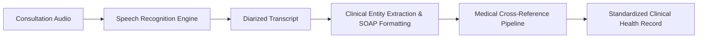

# MediScribe Sage Clinical SOAP Documentation Engine

> AI-assisted clinical transcription system structuring patient consultations into standardized medical records.

[](https://github.com/sohailahmed-bsrh/medi-scribe-sage)
[](https://sohail.devsil.com/projects.html)
[](https://sohail.devsil.com)

---

## Overview

Physicians spend up to 40% of their workday drafting electronic health records, reducing direct patient care time and increasing burnout.

This project provides an end-to-end, reproducible implementation engineered to solve this challenge through verified data transformations, reliable algorithms, and production-ready architecture.

---

## Key Features

- Consultation audio parsing and speaker-differentiated transcription
- Automated clinical entity extraction following standard SOAP (Subjective, Objective, Assessment, Plan) format
- RAG-assisted medical terminology cross-referencing and verification
- Secure web interface with Drizzle ORM schema and Supabase integration

---

## System Architecture



---

## Technology Stack

| Technology | Version / Spec | Role in Architecture |
| :--- | :--- | :--- |
| **Python & FastAPI** | `3.10+` | RAG verification pipeline and clinical parsing |
| **React & Vite** | `18.2+` | Modern clinical consultation interface |
| **Drizzle ORM** | `0.28+` | Database schema management and migrations |
| **Tailwind CSS** | `3.3+` | Responsive UI styling |

---

## Repository Structure

```text
medi-scribe-sage/
|-- rag_pipeline/
|   |-- run.py
|   `-- search.py
|-- src/
|-- drizzle/
|-- .env.example
|-- .gitignore
|-- package.json
`-- README.md
```

---

## Installation and Execution

### Prerequisites
- Node.js 18+ / Python 3.10+
- Git version control

### Setup Instructions
1. Clone the repository:
```bash
git clone https://github.com/sohailahmed-bsrh/medi-scribe-sage.git
cd medi-scribe-sage
```

2. Configure environment and dependencies:
```bash
npm install
cp .env.example .env
npm run dev
```

---

## Interface and Verification
The system produces verifiable execution logs, prediction matrices, or interactive browser interfaces depending on the target mode. Verify operation by executing the commands specified above or inspecting the demonstration notebooks.

---

## Author and Contact
Developed by **Sohail Ahmed** — Full Stack AI Engineer & Machine Learning Specialist.
- **Portfolio:** [sohail.devsil.com](https://sohail.devsil.com)
- **GitHub:** [@sohailahmed-bsrh](https://github.com/sohailahmed-bsrh)
- **Email:** [sohail.bsrh@gmail.com](mailto:sohail.bsrh@gmail.com)

---

## Author & Contact Information

<table width="100%" align="center">
  <tr>
    <td align="center" style="padding: 20px;">
      <h3>Sohail Ahmed</h3>
      <p><strong>Full-Stack Artificial Intelligence & Computer Vision Engineer</strong></p>
      <p>
        <a href="https://sohail.devsil.com"></a>
        <a href="https://github.com/sohailahmed-bsrh"></a>
        <a href="https://linkedin.com/in/sohail-ahmed-dev"></a>
        <a href="mailto:sohail.bsrh@gmail.com"></a>
      </p>
      <p><em>Available for technical roles in Artificial Intelligence, Computer Vision, and Full-Stack Engineering.</em></p>
      <hr style="border: 0; height: 1px; background: #30363d; margin: 15px 0;">
      <small>Distributed under the MIT License.</small>
    </td>
  </tr>
</table>
